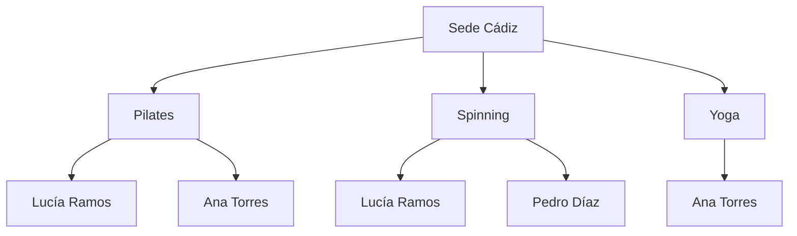
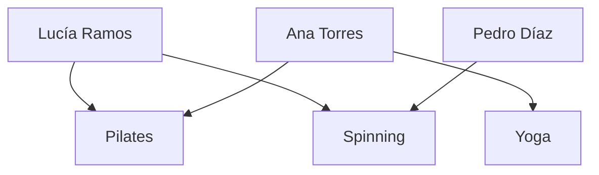

# UD01 - Actividades
## Centros Deportivos Atlántico

| | |
|---|---|
| **Ciclo formativo** | 1º Desarrollo de Aplicaciones Web (DAW) |
| **Módulo profesional** | 0484 · Bases de Datos |
| **Unidad didáctica** | UD1 · Conceptos básicos · Modelos de bases de datos y arquitectura cliente-servidor |
| **Resultado de aprendizaje** | RA1. Reconoce los elementos de las bases de datos, analizando sus funciones y valorando la utilidad de los sistemas gestores. |
| **Criterios de evaluación** | RA1.a · RA1.b · RA1.c · RA1.d · RA1.e · RA1.f · RA1.g · RA1.h · RA1.i · RA1.j |


---

## 1. Objetivo de la actividad

El objetivo de esta actividad es que **apliques** los contenidos de la unidad a un caso realista. No se trata de reproducir definiciones, sino de demostrar que sabes **analizar** un sistema de información, **detectar** sus problemas, **proponer** soluciones y **justificar** tus decisiones técnicas.

---

## 2. Descripción del caso

**Centros Deportivos Atlántico** es una cadena de gimnasios con tres sedes en la provincia de Cádiz: **Cádiz**, **Jerez** y **San Fernando**. Cuenta con unos 1.800 socios.

### 3.1. Situación actual

Cada sede dispone de un ordenador en recepción donde se guarda la información en **ficheros independientes**. La sede de Cádiz utiliza ficheros de texto con campos de longitud fija; la de Jerez, una hoja de cálculo; y la de San Fernando, un fichero de texto con los campos en otro orden. Hay programas sencillos, escritos hace años por un informático externo, que leen estos ficheros para emitir los recibos mensuales.

Los socios pueden contratar tres tarifas: **Básica** (una sede), **Premium** (una sede con clases ilimitadas) y **Multisede** (acceso a las tres sedes).

**Extracto del fichero `SOCIOS` · Sede Cádiz**

| Nº_SOCIO | DNI | NOMBRE | APELLIDOS | DIRECCIÓN | CP | TELÉFONO | IBAN | TARIFA | PRECIO |
|---|---|---|---|---|---|---|---|---|---|
| C-014 | 31234567A | Lucía | Ramos Gil | C/ Sopranis, 12 | 11005 | 600111222 | ES12 **** 3456 | Multisede | 45 € |
| C-015 | 44556677B | Pedro | Díaz Mora | Av. Andalucía, 3 | 11008 | 600333444 | ES98 **** 1122 | Básica | 30 € |
| C-016 | 77889900C | Ana | Torres Vela | C/ Ancha, 7 | 11001 | 600555666 | ES45 **** 7788 | Básica | 32 € |

**Extracto del fichero `SOCIOS` · Sede Jerez**

| Nº_SOCIO | DNI | NOMBRE | APELLIDOS | DIRECCIÓN | CP | TELÉFONO | IBAN | TARIFA | PRECIO |
|---|---|---|---|---|---|---|---|---|---|
| J-102 | 31234567A | Lucía | Ramos Gil | C/ Larga, 40 | 11402 | 600111222 | ES12 **** 3456 | Multisede | 45 € |

**Extracto del fichero `CLASES` · Sede Cádiz**

| COD_CLASE | NOMBRE | DÍA Y HORA | MONITOR | AFORO | PLAZAS_LIBRES |
|---|---|---|---|---|---|
| PIL-1 | Pilates | Lunes 18:00 | Marta Gómez | 15 | 4 |
| SPI-1 | Spinning | Miércoles 19:00 | Andrés Vela | 20 | 1 |
| YOG-1 | Yoga | Jueves 10:00 | Marta Gómez | 12 | 6 |

**Extracto del fichero `RESERVAS` · Sede Cádiz**

```
Nº_SOCIO | NOMBRE_SOCIO | CLASE_1, DÍA_HORA_1, MONITOR_1          | CLASE_2, DÍA_HORA_2, MONITOR_2
C-014    | Lucía Ramos  | Pilates, Lunes 18:00, Marta Gómez       | Spinning, Miércoles 19:00, Andrés Vela
C-015    | Pedro Díaz   | Spinning, Miércoles 19:00, Andrés Vela  | —
C-016    | Ana Torres   | Pilates, Lunes 18:00, Marta Gómez       | Yoga, Jueves 10:00, Marta Gómez
C-999    | (sin nombre) | Yoga, Jueves 10:00, Marta Gómez         | —
```

### 3.2. Incidencias registradas el último trimestre

| Nº | Incidencia |
|---|---|
| **I1** | Lucía Ramos comunicó en la sede de Cádiz su cambio de domicilio. Un mes después, la sede de Jerez le sigue enviando la correspondencia a su dirección antigua. |
| **I2** | Un miércoles, la recepcionista del mostrador y la que atendía el teléfono asignaron **a la vez** la última plaza de Spinning. A la clase acudieron 21 personas para un aforo de 20. |
| **I3** | La gerente pidió un listado de los socios de las tres sedes con código postal 11005. El informático respondió que necesitaba **escribir un programa nuevo** y antes **unificar los formatos** de los tres ficheros, y presupuestó dos semanas de trabajo. |
| **I4** | Los monitores utilizan el ordenador de recepción para consultar sus clases y **pueden ver el IBAN** de todos los socios. |
| **I5** | En el fichero `RESERVAS` figura una reserva del socio **C-999**, que no existe en el fichero `SOCIOS`. |
| **I6** | Para poder guardar teléfonos con prefijo internacional se amplió la longitud del campo `TELÉFONO`. Al día siguiente **dejó de funcionar el programa de recibos**. |
| **I7** | Dos socios con la misma tarifa Básica pagan precios distintos (30 € y 32 €), sin que nadie sepa cuál es el correcto. |

### 3.3. Plan de futuro

La dirección ha aprobado un plan con los siguientes objetivos:

- **Sustituir los ficheros por un Sistema Gestor de Bases de Datos** relacional.
- Lanzar una **aplicación móvil** para que los socios consulten horarios y reserven clases.
- **Expandirse en tres años a 20 sedes** en tres zonas: **Cádiz**, **Sevilla** y **Málaga**, con unos 15.000 socios.
- **Analizar el histórico** de reservas y accesos para decidir horarios, clases y la ubicación de nuevas sedes.

Personas implicadas en el proyecto:

- **La gerente**, que decide qué información necesita la empresa.
- **Un técnico de sistemas** contratado para instalar, configurar y administrar la base de datos.
- **Una empresa de desarrollo** que programará la aplicación móvil.
- **Las recepcionistas**, **el personal de administración**, **los monitores** y **los socios**.

---

## 3. Actividades

### Actividad 1. Análisis del sistema actual de ficheros · RA1.a 

**1.1.** Para **cada incidencia** (I1 a I7), indica qué problema propio de los sistemas de ficheros la ha provocado y **explica por qué** la organización actual la hace posible. Debes señalar los **datos concretos** de los extractos que lo demuestran.

| Incidencia | Problema de los sistemas de ficheros | Explicación aplicada al caso (con datos de los extractos) |
|---|---|---|
| I1 | Redundancia e inconsistencia de datos|Lucía Ramos está dada de alta por duplicado en ficheros independientes: en Cádiz (Nº_SOCIO C-014, C/ Sopranis, 12) y en Jerez (Nº_SOCIO J-102, C/ Larga, 40). Al no estar centralizada la información, la actualización en Cádiz no se propagó a Jerez, dejando datos contradictorios. |
| I2 | Falta de control de concurrencia | Dos recepcionistas accedieron y modificaron simultáneamente el fichero/registro de la clase SPI-1 (Spinning, aforo 20). Al no haber un motor que bloquee y controle los accesos concurrentes, ambas leyeron la última plaza libre y la asignaron a la vez, provocando sobreocupación (21 personas para 20 plazas).|
| I3 | Aislamiento de datos (dificultad de acceso / falta de flexibilidad)|Cada sede usa un formato distinto: Cádiz (texto con campos de longitud fija), Jerez (hoja de cálculo) y San Fernando (fichero de texto con otro orden de campos). Los datos están aislados en formatos incompatibles|
| I4 | Falta de seguridad y control de acceso (ausencia de vistas/autorizaciones) | En un sistema de ficheros, el acceso se suele dar a nivel de archivo completo. Al no haber mecanismos para definir permisos por perfil ni vistas lógicas que oculten columnas sensibles, los monitores ven todo el fichero SOCIOS, exponiendo datos bancarios confidenciales (IBAN).|
| I5 | Falta de integridad | En el fichero RESERVAS aparece una reserva para C-999 (sin nombre) en la clase de Yoga, pero en el fichero SOCIOS no existe ningún socio registrado con ese identificador. Los ficheros no validan automáticamente que las referencias cruzadas existan.|
| I6 | Dependencia física de datos | El fichero de Cádiz usa registros de longitud fija. El programa de recibos leía los bytes en posiciones fijas; al ampliar el tamaño del campo TELÉFONO, se desplazaron todos los campos posteriores (IBAN, TARIFA, PRECIO), haciendo fallar el software existente. |
| I7 | Falta de integridad | El precio no depende de la tarifa como regla de negocio centralizada, sino que está escrito manualmente en cada línea de socio. En el fichero de Cádiz, Pedro Díaz (C-015) paga 30 € y Ana Torres (C-016) paga 32 € teniendo ambos la tarifa Básica, demostrando inconsistencia por falta de restricciones de validación.| 

| … | | |

**1.2.** El fichero `RESERVAS` repite en cada registro el nombre del socio, el día, la hora y el monitor de cada clase.

- **a)** Explica qué consecuencias tiene esta organización cuando, por ejemplo, Andrés Vela deja de impartir Spinning.

el nombre del monitor y los datos de la clase están duplicados en cada una de las reservas de los socios (por ejemplo, en C-014 y C-015). Si el monitor cambia, habría que buscar y actualizar línea por línea cada registro de reserva de esa clase. Si se olvida actualizar alguna, el sistema quedará en un estado inconsistente (mostrando distintos monitores para una misma clase). Además, la estructura con campos fijos CLASE_1, CLASE_2 limita rígidamente a 2 las reservas máximas por socio.

- **b)** Propón una **reorganización en varios ficheros** que elimine las repeticiones, indicando los campos de cada uno y el **campo clave**.

### c) Formato de registro del nuevo fichero SOCIOS

#### Estructura de campos


- **c)** Define el **formato de registro** del nuevo fichero `SOCIOS` (campo, nombre, tipo y longitud) e indica su campo clave. Justifica por qué no has elegido `NOMBRE` como clave.

| Campo | Nombre | Tipo de dato | Longitud | Descripción |
| :---: | :--- | :--- | :---: | :--- |
| 1 | `N_SOCIO` | Alfanumérico (Texto) | 6 | Identificador único del socio (ej. 'C-014') |
| 2 | `DNI` | Alfanumérico (Texto) | 9 | DNI/NIE con letra (ej. '31234567A') |
| 3 | `NOMBRE` | Texto | 30 | Nombre de pila del socio |
| 4 | `APELLIDOS` | Texto | 50 | Apellidos del socio |
| 5 | `DIRECCION` | Texto | 60 | Vía pública y número |
| 6 | `CP` | Texto | 5 | Código postal |
| 7 | `TELEFONO` | Texto | 15 | Teléfono de contacto (con prefijo opcional) |
| 8 | `IBAN` | Alfanumérico (Texto) | 24 | Código de cuenta bancaria |
| 9 | `ID_TARIFA` | Alfanumérico (Texto) | 4 | Clave que referencia a la tarifa contratada |

* **Campo clave elegido:** `N_SOCIO` (o alternativamente `DNI`).
* **Justificación de por qué no se elige `NOMBRE` como clave:**
  Un campo clave (clave primaria) debe cumplir de forma estricta los principios de **unicidad** y **no nulidad**. El campo `NOMBRE` no garantiza la unicidad debido a la existencia habitual de personas homónimas (dos socios distintos pueden llamarse "Lucía" o "Pedro"). Si se utilizara como clave, el sistema impediría registrar a un segundo socio con el mismo nombre o sobreescribiría por error los datos del socio anterior.

---

### Actividad 2. Utilidad de un Sistema Gestor de Bases de Datos · RA1.d 

**2.1.** Explica cómo resolvería un SGBD **cada una de las incidencias** de la actividad 1. Relaciona cada solución con la **ventaja concreta** del SGBD que la hace posible.


| Incidencia | Solución aportada por el SGBD | Ventaja concreta del SGBD |
| :---: | :--- | :--- |
| **I1** | Centralización de los datos en una única base de datos compartida por todas las sedes. Al actualizarse la dirección en un único registro de la tabla `SOCIOS`, el cambio queda visible de inmediato para Cádiz, Jerez y San Fernando. | **Control y eliminación de la redundancia e inconsistencia de datos**. |
| **I2** | Gestión de transacciones concurrentes mediante mecanismos de bloqueo y aislamiento (propiedades ACID). Las operaciones simultáneas se serializan, permitiendo reservar la última plaza al primer usuario y denegando la del segundo por falta de aforo. | **Control de concurrencia automático**. |
| **I3** | Almacenamiento unificado en tablas relacionales estándar que permiten realizar consultas directas mediante SQL (`SELECT * FROM SOCIOS WHERE CP = '11005';`) sin necesidad de programar herramientas de lectura a medida. | **Lenguaje estándar universal de alto nivel (SQL) y facilidad de acceso / flexibilidad**. |
| **I4** | Definición de permisos por perfiles mediante DCL (`GRANT`) y creación de vistas externas personalizadas que ocultan columnas sensibles como el `IBAN` al personal que no requiere verlas (monitores). | **Seguridad y privacidad (control de acceso y vistas externas)**. |
| **I5** | Definición del campo `N_SOCIO` en `RESERVAS` como clave foránea (`FOREIGN KEY`) vinculada a la clave primaria de `SOCIOS`. El motor rechaza de forma automática cualquier intento de insertar un socio inexistente. | **Mantenimiento automático de la integridad referencial**. |
| **I6** | Separación estricta entre la capa lógica/conceptual y el almacenamiento físico (arquitectura ANSI/SPARC). Modificar la longitud de un campo no altera los desplazamientos en disco ni rompe los programas existentes que consultan los datos por nombre de columna. | **Independencia física y lógica de datos**. |
| **I7** | Creación de una tabla independiente `TARIFAS(ID_TARIFA, NOMBRE, PRECIO)` relacionada con los socios. El precio se define en un único lugar centralizado y el motor impide introducir importes arbitrarios. | **Integridad semántica y consistencia de datos**. |

**2.2.** La gerente se pregunta si el cambio "merece la pena". Analiza qué **inconvenientes** tendrá la implantación de un SGBD **para esta empresa en concreto** y emite una recomendación razonada.

#### Inconvenientes para Centros Deportivos Atlántico:
1. **Coste económico inicial elevado:** Inversión en equipamiento/servidores o infraestructura en la nube, adquisición de licencias (si no se opta por software libre) y contratación de personal cualificado (técnico de sistemas/DBA y equipo de desarrollo para la app).
2. **Complejidad y tiempo de migración:** Necesidad de depurar, unificar y convertir los datos heterogéneos existentes en las tres sedes (archivos de texto plano de longitud fija en Cádiz, hojas de cálculo en Jerez y formatos alternativos en San Fernando) hacia el nuevo esquema relacional.
3. **Curva de aprendizaje y capacitación:** Esfuerzo formativo para recepcionistas, monitores y personal de administración en el manejo del nuevo software y procedimientos de trabajo.
4. **Dependencia y mantenimiento continuo:** Necesidad de planificar políticas periódicas de copias de seguridad (backups), monitorización de rendimiento, actualizaciones de parches de seguridad y gestión de perfiles de usuario.

#### Recomendación razonada:
**Rotundamente SÍ merece la pena.**  
Actualmente, la empresa cuenta con 1.800 socios repartidos en tres sedes y sufre graves fallos operativos diarios (sobreventa de aforo por falta de concurrencia, datos bancarios expuestos y cobros erróneos de cuotas). Su plan estratégico prevé una expansión a 20 sedes, 15.000 socios y una app móvil en tiempo real. Mantener un sistema obsoleto basado en ficheros aislados haría inviable la empresa a corto plazo por colapso administrativo y riesgos legales (RGPD). La implantación de un SGBD relacional es la única opción escalable y segura.

---

**2.3.** Un monitor que trabaja como entrenador personal por su cuenta, con 12 clientes, guarda en un fichero de texto la fecha y el tipo de sesión de cada cliente. ¿Le recomendarías un SGBD? Justifica tu respuesta comparándola con la de Centros Deportivos Atlántico.

* **¿Se le recomendaría un SGBD corporativo?**  
  **No se le recomendaría** implantar un SGBD cliente-servidor tradicional (como PostgreSQL, MySQL Server u Oracle).

* **Justificación comparativa:**
  * **Volumen de datos:** El monitor maneja únicamente 12 clientes y sus registros de sesiones, una cantidad mínima que cabe en cualquier archivo o libreta digital, frente a los 1.800 (y futuros 15.000) socios de Centros Deportivos Atlántico.
  * **Concurrencia:** El monitor trabaja solo (**monousuario**); no existen accesos simultáneos que requieran mecanismos de bloqueo ni control de transacciones, mientras que la cadena de gimnasios sufre colisiones en tiempo real entre recepcionistas y futuros accesos móviles.
  * **Coste / Beneficio:** El coste en licencias, hardware dedicado o complejidad técnica de administración superaría con creces los beneficios obtenidos. 
  * **Solución adecuada:** Al monitor le basta una solución mono-equipo sencilla y ligera, como una hoja de cálculo o una base de datos embebida de archivo local único (tipo **SQLite** o **Microsoft Access**).
---

### Actividad 3. Elementos de un SGBD · RA1.e

**3.1.** Una vez implantado el SGBD, se producen las situaciones siguientes. Para cada una, indica **qué elemento del SGBD interviene** (núcleo, DDL, DML, DCL, utilidades o diccionario de datos), **qué tipo de usuario la realiza** (administrador de datos, administrador de la base de datos, programador de aplicaciones, usuario final o ninguno si es automática) y **justifica** brevemente tu respuesta.

| Nº | Situación | Elemento del SGBD | Tipo de usuario | Justificación |
|---|---|---|---|---|
| 1 | La gerente decide que a partir de ahora se registrará un teléfono de emergencia de cada socio. El cambio se aplicará modificando la estructura de la tabla `SOCIOS`. |DDL (Lenguaje de Definición de Datos) |Administrador de datos |La gerente define la necesidad de información del negocio a nivel estratégico/conceptual; el cambio requiere alterar la definición del esquema (DDL). |
| 2 | El técnico ejecuta `CREATE TABLE RESERVAS (...)`. |DDL |Administrador de la base de datos |Es una sentencia de creación de estructuras de datos ejecutada directamente por el responsable técnico de la BD |
| 3 | Una recepcionista consulta, desde el programa de recepción, qué clases del jueves tienen plazas libres. |DML (Lenguaje de Manipulación de Datos) |Usuario final |El programa ejecuta un SELECT por debajo; la recepcionista interactúa con la interfaz para consultar datos diarios. |
| 4 | Se ejecuta `GRANT SELECT ON CLASES TO monitores;` |DCL (Lenguaje de Control de Datos) |Administrador de la base de datos |GRANT gestiona privilegios de seguridad y autorización sobre los objetos de la base de datos. |
| 5 | El SGBD rechaza una reserva porque el número de socio no existe. |Núcleo / Motor del SGBD |automática |El motor valida automáticamente las restricciones de clave ajena en tiempo de ejecución sin intervención humana. |
| 6 | Dos recepcionistas intentan asignar a la vez la última plaza de Spinning; el SGBD solo acepta una de las dos operaciones. |Núcleo /Motor del SGBD|automática |El planificador de transacciones gestiona los bloqueos y serializa el acceso concurrente. |
| 7 | El técnico consulta qué tablas existen, qué campos tienen y qué usuarios tienen permisos sobre ellas. |Diccionario de datos |Administrador de la base de datos | Consulta los metadatos del sistema (datos sobre los datos).   |
| 8 | Administración genera el informe mensual de cuotas con un asistente gráfico, sin escribir código. |Herramientas de desarrollo |Usuario Final |Utiliza herramientas de alto nivel proporcionadas por el software sin escribir sentencias SQL. |
| 9 | Se cargan en la nueva base de datos los ficheros antiguos de las tres sedes. |Utilidades | Administrador de la base de datos|Empleo de herramientas del SGBD destinadas a la carga masiva y migración de datos. |
| 10 | La empresa de desarrollo programa la pantalla de reservas de la app, que resta una plaza libre cada vez que un socio reserva. |DML embebido / API de acceso a datos |Programador | Los desarrolladores escriben el código de la aplicación que interactúa con la BD mediante sentencias DML.|

**3.2.** Analiza los cambios siguientes. Para cada uno, indica **qué nivel de la arquitectura** de la base de datos se modifica (interno, conceptual o externo), **qué tipo de independencia** de datos interviene (si procede) y **qué programas o usuarios se ven afectados**.

| Cambio | Nivel modificado | Independencia | ¿A quién afecta? |
|---|---|---|---|
| a) El técnico reorganiza el almacenamiento de `SOCIOS` y crea un índice sobre el DNI para acelerar las búsquedas. |Interno (físico) |Independencia física |A nadie en su operativa. Las consultas y programas siguen funcionando exactamente igual, únicamente experimentan una mejora de rendimiento (mayor velocidad). |
| b) Se añade el campo `TELEFONO_EMERGENCIA` a `SOCIOS`. |Conceptual (lógico) | Independencia lógica|Solo a las nuevas funciones/pantallas que requieran gestionar dicho teléfono. Los programas existentes que no usan este campo siguen funcionando intactos. |
| c) Se crea una vista para los monitores que muestra solo el nombre del socio y sus clases. |Externo |Independencia lógica |A los monitores, que ahora disponen de una interfaz personalizada adaptada a sus necesidades y restringida por seguridad. |
| d) Se elimina el campo `FAX` de `SOCIOS`, que solo usaba el antiguo programa de envío de cartas. |Conceptual | Independencia lógica| Al antiguo programa de cartas (si se ejecutase). Los programas actuales de recepción, cobros o reservas no se ven afectados.|

Por último, compara el cambio *b* con la incidencia **I6** y explica qué ha cambiado gracias al SGBD.

**En la incidencia I6**, al cambiar la longitud física de un campo dentro de un fichero plano, se rompió el programa de recibos porque este dependía directamente del orden y la posición fija de los bytes en el almacenamiento.

**Con el SGBD (cambio b)**, gracias a la independencia lógica y física, la estructura de las tablas está desligada de cómo los programas acceden a los campos. Las consultas piden los datos por su nombre de columna (SELECT NOMBRE, IBAN FROM SOCIOS), por lo que añadir una nueva columna no altera los programas existentes.

---

### Actividad 4. Modelos de datos · RA1.b 

Utiliza los datos de reservas de la sede de Cádiz (excluyendo la reserva errónea de C-999):

- Lucía Ramos → Pilates y Spinning.
- Pedro Díaz → Spinning.
- Ana Torres → Pilates y Yoga.

**4.1.** **Modelo jerárquico.** Representa la información en forma de árbol, tomando como raíz la *Sede Cádiz*, después las *clases* y, por debajo, los *socios*. Indica qué datos aparecen **duplicados** y explica por qué este modelo obliga a ello.




**4.2.** **Modelo en red.** Representa la misma información como red. Señala qué nodos tienen **más de un padre** y explica qué ventaja supone respecto al modelo jerárquico.


**4.3.** **Modelo relacional.**

- **a)** Diseña las tablas `SOCIOS`, `CLASES` y `RESERVAS` con sus campos e indica la **clave primaria** y las **claves externas** de cada una.
- **b)** Rellena las tres tablas con los datos anteriores.
- **c)** Explica por qué es necesaria la tabla `RESERVAS` y por qué en ella un mismo valor de clave externa puede repetirse.

**Tabla: SOCIOS**
* **Clave Primaria (PK):** `N_SOCIO`
* **Claves Externas (FK):** Ninguna

| N_SOCIO (PK) | NOMBRE | APELLIDOS | TARIFA |
| :---: | :--- | :--- | :--- |
| **C-014** | Lucía | Ramos Gil | Multisede |
| **C-015** | Pedro | Díaz Mora | Básica |
| **C-016** | Ana | Torres Vela | Básica |

---

**Tabla: CLASES**
* **Clave Primaria (PK):** `COD_CLASE`
* **Claves Externas (FK):** Ninguna

| COD_CLASE (PK) | NOMBRE | DIA_HORA | MONITOR | AFORO |
| :---: | :--- | :--- | :--- | :---: |
| **PIL-1** | Pilates | Lunes 18:00 | Marta Gómez | 15 |
| **SPI-1** | Spinning | Miércoles 19:00 | Andrés Vela | 20 |
| **YOG-1** | Yoga | Jueves 10:00 | Marta Gómez | 12 |

---

**Tabla: RESERVAS**
* **Clave Primaria (PK):** Compuesta por (`N_SOCIO`, `COD_CLASE`)
* **Claves Externas (FK):**
  * `N_SOCIO` -> referencia a `SOCIOS(N_SOCIO)`
  * `COD_CLASE` -> referencia a `CLASES(COD_CLASE)`

| N_SOCIO (PK, FK1) | COD_CLASE (PK, FK2) | FECHA_RESERVA |
| :---: | :---: | :---: |
| **C-014** | **PIL-1** | 2026-11-01 |
| **C-014** | **SPI-1** | 2026-11-01 |
| **C-015** | **SPI-1** | 2026-11-02 |
| **C-016** | **PIL-1** | 2026-11-02 |
| **C-016** | **YOG-1** | 2026-11-03 |

---

#### c) Justificación de la tabla intermedia y repetición de claves externas

* **Por qué es necesaria la tabla RESERVAS:**  
  La relación entre socios y clases es **muchos a muchos (N:M)**: un socio puede reservar múltiples clases y cada clase acoge a muchos socios. En el modelo relacional, los atributos deben ser atómicos (no se permiten listas, vectores ni campos multivaluados dentro de una misma celda). Para resolver una relación N:M respetando la normalización, es obligatorio descomponerla en dos relaciones 1:N mediante una **tabla intermedia**, donde cada tupla representa un único vínculo individual entre un socio y una clase.
* **Por qué puede repetirse un mismo valor de clave externa:**  
  Una clave foránea representa el lado "muchos" (N) de la asociación. El identificador `C-014` aparece dos veces porque la socia Lucía tiene dos reservas activas (`PIL-1` y `SPI-1`). De igual manera, `PIL-1` se repite porque asisten tanto Lucía como Ana. La restricción de unicidad no se aplica a cada clave externa por separado, sino a la **clave primaria compuesta conjunta** (`N_SOCIO` + `COD_CLASE`), lo que garantiza que un socio no pueda reservar dos veces exactamente la misma clase.


**4.4.** Justifica cuál de los tres modelos es el adecuado para Centros Deportivos Atlántico. Indica además **una parte del sistema** de la empresa (actual o futura) en la que una estructura jerárquica sí tendría sentido y por qué.

### 4.4. Justificación del modelo y uso de la estructura jerárquica

* **Modelo más acertado y por qué:**  
  El **modelo relacional**.  
  **Por qué:** Porque las relaciones principales del gimnasio son **muchos a muchos (N:M)**: un socio reserva varias clases y cada clase acoge a muchos socios. El modelo jerárquico no permite relaciones N:M (obligaría a duplicar datos), y el modelo en red usa punteros físicos complejos y carece de un estándar como SQL. El relacional resuelve esto de forma limpia con tablas intermedias, garantiza la integridad referencial, soporta la concurrencia que exige la futura app móvil y permite escalar a las 20 sedes y 15.000 socios previstos.

---

* **Situación (actual o futura) donde tiene sentido el modelo jerárquico y por qué:**  
  La **estructura territorial de las sedes** (Zona -> Sede -> Sala).  
  **Por qué:** Sigue una relación estricta de árbol **uno a muchos (1:N)**. Cada zona (Cádiz, Sevilla, Málaga) tiene varias sedes, cada sede pertenece a una sola zona, y cada sala pertenece a una única sede. Ningún elemento hijo tiene más de un padre (una sala nunca está en dos sedes a la vez), por lo que una jerarquía pura encaja a la perfección sin duplicar datos.

---

### Actividad 5. Clasificación de los sistemas gestores · RA1.f 

**5.1.** Clasifica los siguientes sistemas completando la tabla. Si un sistema **no es un SGBD**, indícalo y explica el motivo.

| Sistema | ¿Es un SGBD? | Modelo de datos | Ubicación de la información (centralizada / distribuida) | Usuarios (uno / varios simultáneos) | Configuración (monoequipo / cliente-servidor / con servidor de aplicaciones / distribuida) |
|---|---|---|---|---|---|
| A. El sistema actual de cada sede, con ficheros en el ordenador de recepción. |No (es un sistema de ficheros tradicional; no gestiona concurrencia, integridad ni catálogo) |No aplica (ficheros planos / hojas de cálculo) |Centralizada |Uno (monousuario) | Monoequipo|
| B. El entrenador personal de la actividad 2.3 instala SQLite en su portátil para gestionar a sus clientes. | Sí (SGBD relacional embebido)|Relacional |Centralizada |Uno (monousuario) | Monoequipo|
| C. Un SGBD jerárquico, similar a IBM IMS, instalado en un servidor central al que se conectan varios terminales. | Sí|Jerárquico |Centralizada | Varios simultáneos (multiusuario)|Cliente-servidor |
| D. MySQL instalado en un servidor de la sede de Cádiz, al que se conectan las recepciones de las tres sedes. | Sí   | Relacional| Centralizada| Varios simultáneos (multiusuario)| Cliente-servidor|
| E. La app móvil se comunica con un servidor de aplicaciones que, a su vez, consulta una base de datos PostgreSQL. |Sí |Relacional |Centralizada |Varios simultáneos (multiusuario) |Con servidor de aplicaciones (3 niveles) |
| F. Tras la expansión, cada zona tiene su propio servidor PostgreSQL y el conjunto funciona como una única base de datos. | Sí|Relacional | Distribuida| Varios simultáneos (multiusuario) |Distribuida |

**5.2.** Los ficheros de las tres sedes ya están repartidos en tres ordenadores distintos. ¿Puede considerarse el sistema actual una **base de datos distribuida**? Justifica tu respuesta.

**No, no puede considerarse una base de datos distribuida**
**Justificación:**  
Para que exista una base de datos distribuida, los datos deben estar repartidos en distintos nodos conectados por red pero gobernados por un software que ofrezca **transparencia de distribución**, de modo que para el usuario y las aplicaciones el conjunto funcione y se consulte como **una única base de datos lógica**. 

En Centros Deportivos Atlántico los ordenadores contienen ficheros independientes, con formatos distintos e incompatibles entre sí (texto plano con formato fijo en Cádiz, hoja de cálculo en Jerez y otro orden en San Fernando), sin sincronización, sin comunicación en red y sin ningún software que los integre bajo una visión unificada. Son simplemente sistemas de ficheros aislados.

---

### Actividad 6. Ubicación de la información y bases de datos distribuidas · RA1.c · RA1.g

**6.1.** Para afrontar la expansión a 20 sedes, el técnico plantea cuatro opciones. Completa la tabla **aplicándola al caso**:

| Opción | ¿Dónde se encuentra físicamente la información? | Ventaja principal para Atlántico | Inconveniente principal para Atlántico |
| :--- | :--- | :--- | :--- |
| **1. Cada sede con su propio SGBD en el ordenador de recepción (monoequipo).** | Descentralizada y aislada en el disco duro del PC de recepción de cada una de las 20 sedes. | Total autonomía local; cada sede opera sin depender de conexión a Internet ni de servidores externos. | Hace inviable la tarifa Multisede y la app móvil global, ya que los datos no se comparten entre sedes. |
| **2. Un único servidor central en Cádiz al que se conectan todas las sedes (cliente-servidor).** | Centralizada físicamente en el servidor de la sede de Cádiz. | Administración unificada y sencilla; todos los datos y reservas se consultan y actualizan en tiempo real. | **Punto único de fallo**: si cae el servidor de Cádiz o falla la red, las 20 sedes se quedan sin servicio. |
| **3. Un servidor en cada zona (Cádiz, Sevilla y Málaga) formando una base de datos distribuida.** | Distribuida físicamente entre los tres servidores zonales conectados en red. | **Alta disponibilidad y tolerancia a fallos**: si falla una zona, las otras dos siguen funcionando con normalidad. | **Gran complejidad técnica**: requiere gestionar transacciones distribuidas, replicación y sincronización. |
| **4. Cualquiera de las anteriores con un servidor de aplicaciones intermedio para la app móvil.** | En el servidor/nodos de base de datos (capa de datos desacoplada). | **Seguridad y cliente ligero**: la app móvil no accede directo a la BD; centraliza las reglas de negocio y escala mejor. | Mayor coste y mantenimiento al tener que desplegar y administrar una máquina/capa intermedia adicional. |

**6.2.** Describe, paso a paso, qué ocurre desde que una socia pulsa *Reservar* en la app hasta que recibe la confirmación. Indica en qué **capa** (presentación, lógica o datos) se produce cada paso y en qué capa debe comprobarse que quedan plazas libres. Justifica esto último.

**Paso a paso por capas:**
1. **Capa de Presentación (App móvil):** La socia selecciona la clase y pulsa *Reservar*. La app empaqueta la petición y la envía por red hacia el servidor de aplicaciones.
2. **Capa de Lógica de Negocio (Servidor de aplicaciones):** Recibe la solicitud, autentica a la socia, comprueba que está al corriente de pago y que su tarifa admite dicha reserva. A continuación, genera la petición de reserva hacia el SGBD.
3. **Capa de Datos (SGBD):** Ejecuta la transacción de reserva dentro de la base de datos. Comprueba que `PLAZAS_LIBRES > 0`, descuenta una plaza, inserta la tupla en `RESERVAS` y confirma la operación (`COMMIT`). Devuelve el resultado afirmativo a la lógica de negocio.
4. **Capa de Lógica de Negocio:** Recibe la confirmación del SGBD y devuelve un mensaje de éxito en formato JSON a la app.
5. **Capa de Presentación:** Recibe la respuesta y muestra en pantalla: *"Reserva realizada con éxito"*.

* **¿En qué capa debe comprobarse que quedan plazas libres y justificación?**  
  Debe comprobarse y confirmarse de manera definitiva en la **capa de datos (SGBD)**.  
  **Justificación:** Si se comprobara únicamente en la capa de presentación (la app) o antes de bloquear el dato, dos socias podrían consultar la última plaza libre a la vez, pulsar el botón al mismo tiempo y provocar sobreocupación (como ocurrió en la incidencia I2). Solo el motor del SGBD, mediante transacciones ACID y bloqueos concurrentes sobre la fila de la clase, garantiza que la plaza se verifique y descuente de forma indivisible.

  

**6.3.** Analiza cómo responderían la opción 2 (centralizada) y la opción 3 (distribuida) ante estas situaciones:

- **a)** Un lunes a las 19:00, hora punta, se produce un corte eléctrico en el edificio donde está el servidor de Cádiz.
- **b)** Lucía Ramos, con tarifa Multisede y dada de alta en Cádiz, reserva una clase en una sede de Málaga. Explica qué debe ocurrir para que la socia **perciba un único sistema** y qué dificultad técnica supone.

#### a) Corte eléctrico en el edificio del servidor de Cádiz (lunes a las 19:00, hora punta):
* **Opción 2 (Centralizada):** **Caída total del negocio.** Al estar el único servidor en Cádiz, las 20 sedes (incluidas las de Sevilla y Málaga) y la app móvil pierden el acceso a los datos al instante. Nadie puede consultar socios, verificar tarifas ni registrar reservas.
* **Opción 3 (Distribuida):** **Tolerancia parcial a fallos.** Solo deja de estar operativa la zona de Cádiz. Los servidores zonales de Sevilla y Málaga continúan operando con normalidad para sus socios y clases locales.

#### b) Lucía Ramos (tarifa Multisede, alta en Cádiz) reserva una clase en Málaga:
* **Qué debe ocurrir para que perciba un único sistema:**  
  Debe existir **transparencia de distribución y localización**. La app debe permitirle elegir la sede de Málaga sin pedirle cuentas adicionales; el sistema debe consultar su ficha de socia (alojada en el nodo de Cádiz), validar su tarifa Multisede y registrar la reserva en la clase del nodo de Málaga de forma automática.
* **Qué dificultad técnica supone:**  
  Implica ejecutar una **transacción distribuida** que involucra a dos nodos remotos distintos (Cádiz y Málaga) mediante protocolos como el compromiso en dos fases . Si la conexión de red entre ambas ciudades sufre retrasos o microcortes, la operación puede quedar bloqueada o requerir reintentos para no dejar los datos incoherentes.

**6.4.** Recomienda razonadamente una de las opciones para la empresa dentro de tres años, valorando tanto sus ventajas como sus inconvenientes.

**Recomendación:** **Opción 4 sobre una base de datos centralizada de alta disponibilidad en la nube (Arquitectura de 3 niveles: Cliente ligero + Servidor de aplicaciones + SGBD Cloud)**.

* **Valoración de ventajas:**
  * **Idóneo para la app móvil y las 20 sedes:** Al separar la lógica en el servidor de aplicaciones, las recepciones y la app funcionan como clientes ligeros, evitando que los clientes se conecten directamente a la base de datos.
  * **Tarifa Multisede sin fisuras:** Al estar los datos centralizados, cualquier socio de Cádiz, Sevilla o Málaga es reconocido de inmediato en cualquier sede sin la enorme complejidad de sincronización de una BD distribuida.
  * **Menor complejidad operativa:** Una base de datos distribuida zonal pura (Opción 3) exige ingenieros especializados para resolver inconsistencias entre sedes.
* **Valoración de inconvenientes y mitigación:**
  * El riesgo del punto único de fallo de la Opción 2 tradicional se resuelve **alojando el SGBD en un proveedor cloud (BD como servicio, tipo Amazon RDS o Azure)**, que proporciona réplicas automáticas, copias de seguridad continuas y alta disponibilidad sin cortes locales por problemas de un edificio físico.
---

### Actividad 7. Reparto de la información entre servidores (fragmentación) · RA1.h

Cuando se elige una base de datos distribuida, hay que decidir **qué parte de la información se guarda en cada servidor**. A esta división se la denomina **fragmentación**, y puede hacerse de dos formas:

- **Repartir registros (filas)** de una tabla según un criterio, como en el ejemplo de Netflix de la unidad, donde cada servidor regional guarda los datos de los usuarios de su zona.
- **Repartir campos (columnas)** de una misma tabla en servidores distintos, de modo que cada servidor guarda solo una parte de la información de cada registro.

Además, algunas tablas pueden **replicarse**, es decir, guardarse **completas en todos los servidores**.

Tras la expansión, la tabla `SOCIOS` tendría este aspecto (extracto):

| Nº_SOCIO | DNI | NOMBRE | SEDE_ALTA | ZONA | TELÉFONO | IBAN | TARIFA | CUOTA |
|---|---|---|---|---|---|---|---|---|
| CA-014 | 31234567A | Lucía Ramos | Cádiz | Cádiz | 600111222 | ES12 **** 3456 | Multisede | 45 € |
| CA-015 | 44556677B | Pedro Díaz | Jerez | Cádiz | 600333444 | ES98 **** 1122 | Básica | 30 € |
| SE-201 | 12345678D | Javier Ruiz | Sevilla Nervión | Sevilla | 611222333 | ES33 **** 9900 | Premium | 55 € |
| SE-202 | 23456789E | Elena Mena | Dos Hermanas | Sevilla | 622333444 | ES71 **** 4455 | Básica | 30 € |
| MA-301 | 34567890F | Carmen Soto | Málaga Centro | Málaga | 633444555 | ES20 **** 6677 | Multisede | 45 € |
| MA-302 | 45678901G | Luis Peña | Marbella | Málaga | 644555666 | ES88 **** 2211 | Básica | 30 € |

**7.1.** Propón cómo repartir las tablas `SOCIOS`, `CLASES`, `RESERVAS` y `TARIFAS` entre los tres servidores de zona. Para cada tabla indica si la **fragmentarías por registros** (y con qué criterio) o si la **replicarías**, y justifica la decisión pensando en qué datos consulta cada sede con más frecuencia.

**7.2.** Aplica tu criterio al extracto anterior: indica qué registros de `SOCIOS` se almacenarían en cada servidor. Comprueba que ningún registro se pierde ni aparece en dos fragmentos.

**7.3.** El técnico propone además **separar por campos** la tabla `SOCIOS`: los datos bancarios y de cuota se guardarían en un servidor de administración especialmente protegido, y el resto en los servidores de zona.

- **a)** Indica qué campos tendría cada fragmento.
- **b)** ¿Qué campo debe aparecer **en ambos fragmentos** y por qué?
- **c)** Explica qué ventaja aporta esta separación en relación con la incidencia **I4**.

**7.4.** Con tu propuesta, ¿en qué servidor quedaría registrada la reserva que Lucía Ramos (Cádiz, Multisede) hace en Málaga? Analiza qué problema plantea y propón una solución.

---

### Actividad 8. Protección de datos · RA1.i

**8.1.** A partir de los campos de la tabla `SOCIOS`, identifica qué datos son **de carácter personal** e indica cuáles consideras **más delicados** y por qué.

**8.2.** Indica qué **normativa europea** de protección de datos, citada en los materiales de la unidad, debe cumplir Centros Deportivos Atlántico, y explica **con tus palabras** por qué le afecta.

**8.3.** Propón **al menos cuatro medidas técnicas** para proteger los datos de los socios, basadas en los contenidos de la unidad. Al menos una debe resolver la incidencia **I4** y otra debe aplicarse a la app móvil.

| Medida | Concepto de la unidad en el que se basa | Riesgo que evita en Atlántico |
|---|---|---|
| | | |

Incluye en una de las medidas la **sentencia DCL** que utilizarías, siguiendo el ejemplo de la unidad.

---

### Actividad 9. Análisis de datos para la toma de decisiones · RA1.j

En la unidad se han visto plataformas que guardan datos para **analizarlos**: el *microservicio Analytics* con su propia base de datos, los *historiales de visualización* o los *algoritmos de recomendación* de una plataforma de *streaming*.

- Utilizar los datos acumulados de una empresa para **apoyar la toma de decisiones** se denomina **inteligencia de negocio** (*Business Intelligence*, BI).
- Cuando el **volumen** de datos es tan grande, se genera **tan rápido** o es **tan variado** que las herramientas tradicionales no bastan para procesarlo, se habla de **Big Data**.

**9.1.** Dentro de tres años habrá unos 15.000 socios que, de media, realizan 3 reservas por semana. Calcula **cuántas reservas se registrarán al año** y cuántas se acumularán en los tres años. Compara esa cifra con el sistema actual de ficheros y razona si podría gestionarla.

**9.2.** Plantea **tres preguntas de negocio** que la gerente podría responder analizando el histórico. Para cada una, indica **qué tablas y campos** necesitaría y **qué decisión** permitiría tomar.

| Pregunta de negocio | Tablas y campos necesarios | Decisión que permite tomar |
|---|---|---|
| | | |

**9.3.** Siguiendo el ejemplo de los microservicios de la unidad, el técnico propone guardar los datos de análisis en una **base de datos separada** de la que usan la recepción y la app para las reservas. Explica por qué es una buena decisión, relacionándola con algún inconveniente de la arquitectura cliente-servidor visto en la unidad.

---
